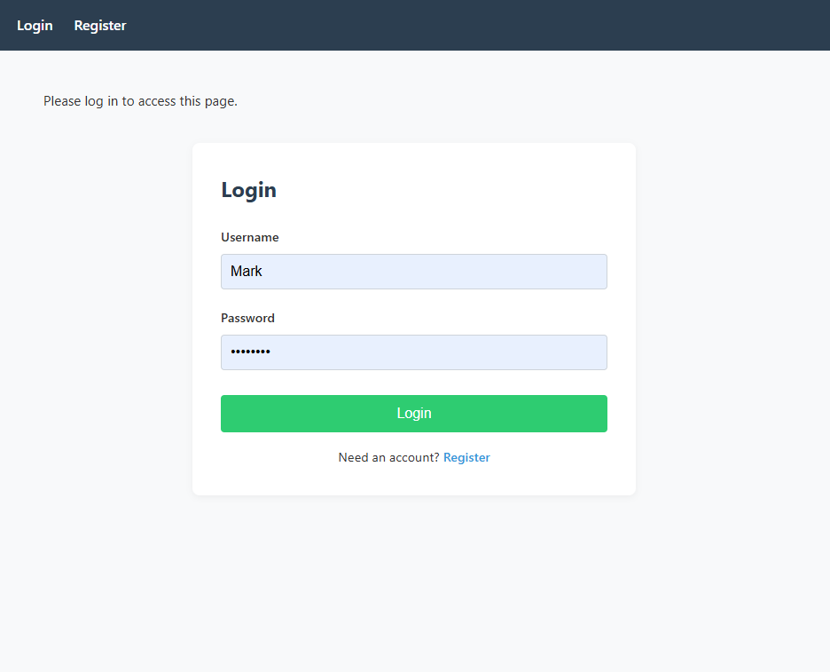
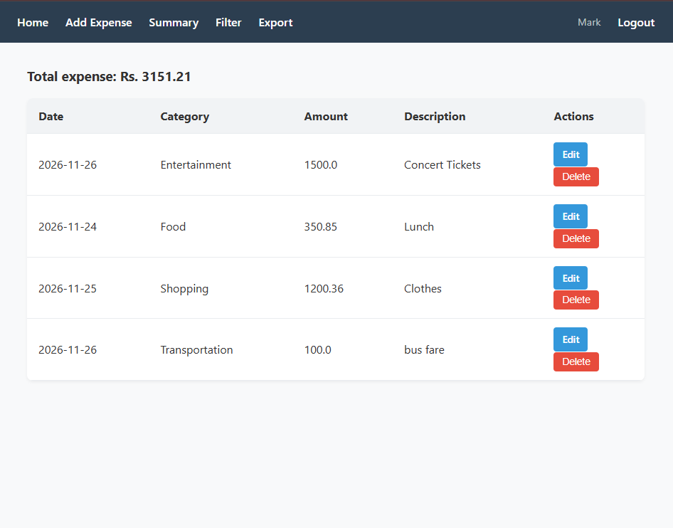
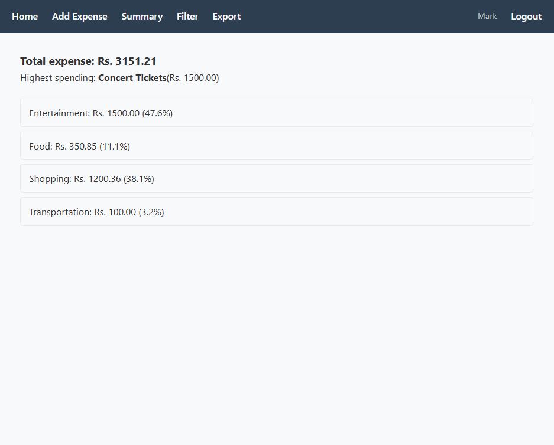
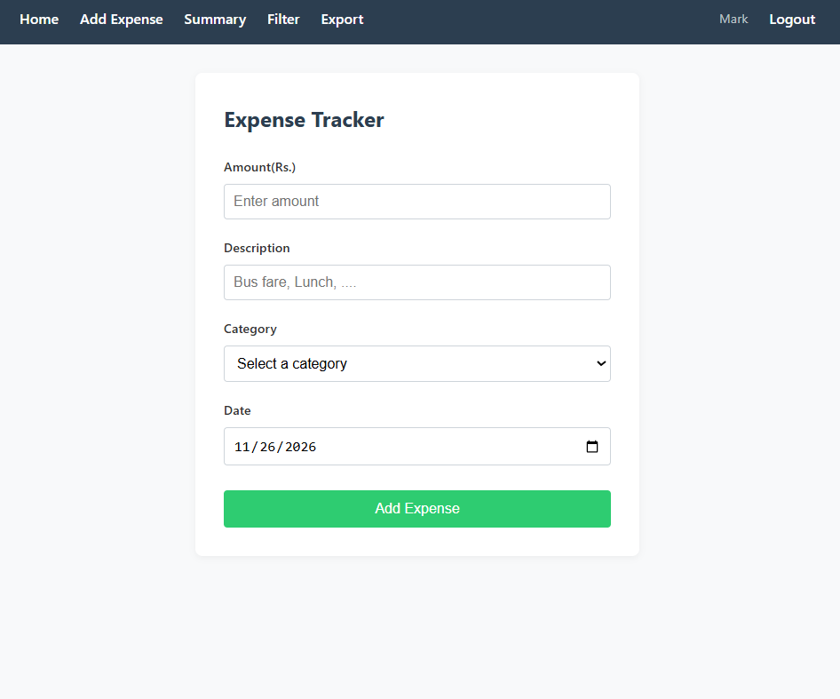
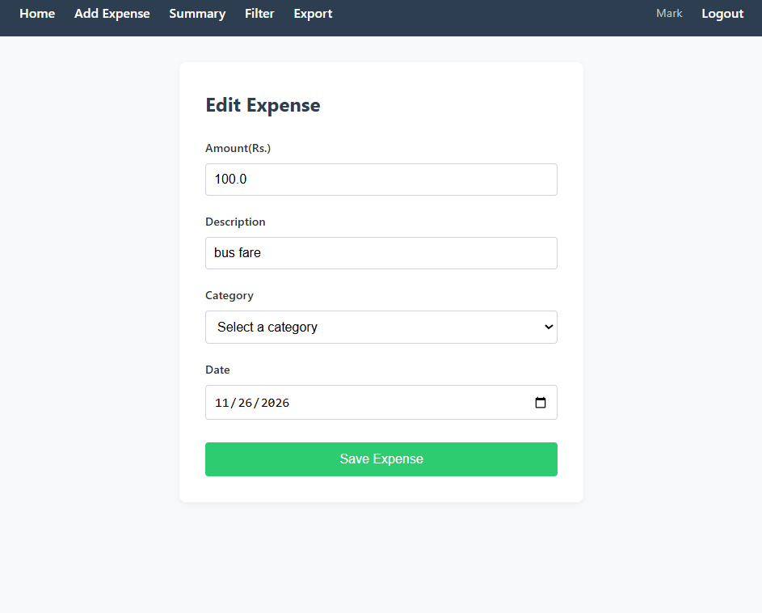

# Expense Tracker

A flask based web application where users track personal expenses and view category summaries. Every user has separate account so the user only sees their own expenses.

## Features:

* User registration, login and logout
* Add and edit expenses with amount, description, category and date
* View expenses in a table and filter by start and end date
* Category summary of the expenses showing category total, percentage share, highest spending and total expense
* Export expenses as CSV file

## Tech stack:

* Flask
* Flask-SQLAlchemy and SQLite
* Flask-Login
* pytest

## Screenshots







## How to Run

Open PowerShell and run these commands one by one:
(Windows)

```powershell
git clone https://github.com/ritikdes/expense-tracker-web.git
cd expense-tracker-web
python -m venv venv
.\venv\Scripts\Activate.ps1
pip install -r requirements.txt
$env:SECRET_KEY="change-this-secret-key"
python app.py
```

(macOS/Linux)
```powershell
git clone [https://github.com/ritikdes/expense-tracker-web.git](https://github.com/ritikdes/expense-tracker-web.git)
cd expense-tracker-web
python3 -m venv venv
source venv/bin/activate
pip install -r requirements.txt
export SECRET_KEY="change-this-secret-key"
python3 app.py
```
Once the server is running, open (`http://127.0.0.1:5000`) in your browser and register a new account.

## Running the Tests

```powershell
python -m pytest
```

## Security Notes
* Passwords are hashed before saving and verified during login using Werkzeug's (`generate_password_hash`) and (`check_password_hash`) rather than storing plain text.
* Routes protected using Flask-Login(`@login_required`) requiring authenticated session and expense queries filter by current_user.id(returning 404 when a user tries to access another users's expense ID)
* An automated test checks anonymous redirects, authenticated views, password validation and in memory database isolation.

## What I Learned
* Setting (`DATABASE_URL`) before importing (`SQLAlchemy`) matters because Flask-SQLAlchemy binds its database engine when initialized, and running tests against an in-memory SQLite database keeps local development data safe.
* Testing HTTP status codes and ownership checks catches real bugs better than only checking response text or total pass counts.


## Limitations and possible improvements
* Logout currently uses a (`GET`) request rather than (`POST`).
* There are no database migrations yet, so schema changes require recreating or manually updating the database.
* Expense amounts are stored as (`Float`), which can suffer from floating-point rounding compared to (`Numeric`) or integer minor units (such as paise/cents).
* Forms do not include CSRF tokens (for example via Flask-WTF).
* There are no password strength rules beyond length and no login rate limiting.